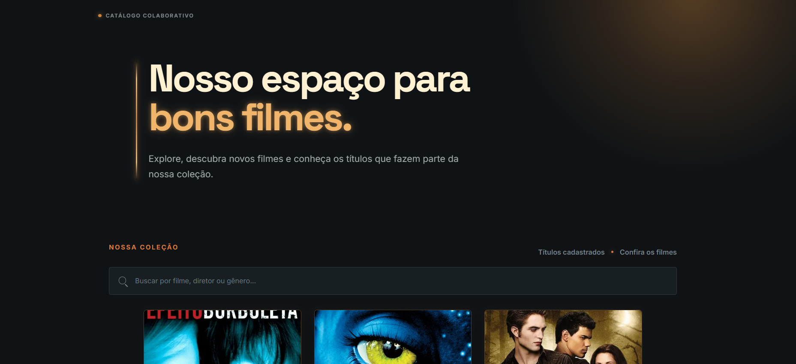
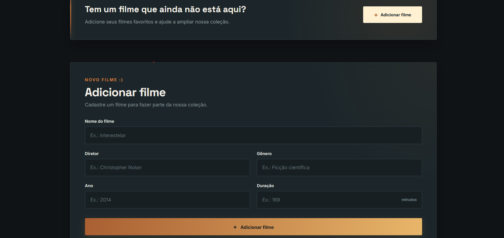
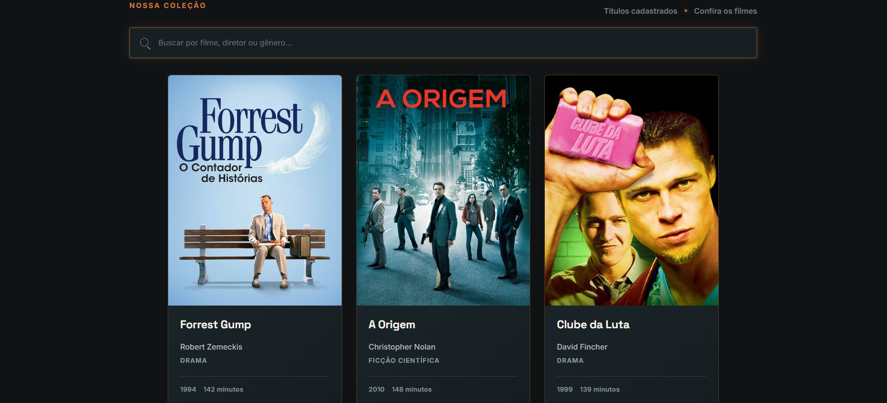

# Projeto Catálogo de Filmes

Desenvolvi este catálogo colaborativo de filmes para praticar **HTML, CSS, JavaScript, Node.js, Express e MySQL**. Também trabalhei com uma API externa, o **TMDB**, que fornece informações e pôsteres de filmes. Assim, ao cadastrar um filme, a aplicação pode buscar automaticamente essas informações e a imagem do pôster, sem que seja necessário inserir tudo manualmente.

Neste projeto coloquei em prática diferentes partes do desenvolvimento de uma aplicação, desde a criação da interface e das interações com o usuário até o armazenamento das informações, a comunicação entre a página e o servidor e a integração com uma API externa. A ideia foi entender, na prática, como essas partes se conectam e funcionam juntas dentro de um mesmo projeto.

---

## Funcionalidades

* Acesso aos filmes cadastrados
* Cadastro de novos filmes
* Busca e consulta dos filmes
* Filtro por gênero
* Armazenamento das informações em MySQL
* Busca de informações e pôsteres através do TMDB
* Preenchimento automático de informações durante o cadastro
* Carrossel para navegação pelos filmes
* Interface responsiva

---

## Preview

### Página inicial

### Cadastro de filme

### Busca e carrossel

---

## Tecnologias utilizadas

* HTML5
* CSS3
* JavaScript
* Node.js
* Express
* MySQL
* MySQL2
* API TMDB

---

## O que pratiquei

Ao desenvolver este projeto, pratiquei:

* Criação e organização da página com HTML
* Estilização da interface com CSS
* Interações com JavaScript
* Criação de um servidor com Node.js e Express
* Comunicação entre a página e o servidor
* Conexão com banco de dados MySQL
* Cadastro e consulta de informações
* Integração com uma API externa
* Organização do projeto
* Uso do Git e GitHub para acompanhar as alterações

---

Desenvolvido por **Eduarda de Souza Ribeiro**
Estudante de Engenharia de Software
